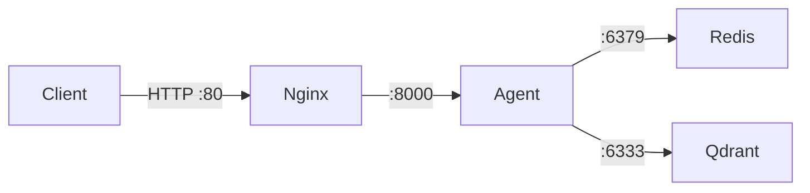

# Day 14 — Mission Answers

Ngày thực hiện: 26/11/2026. Các ví dụ dùng mock LLM, không gọi API tính phí. Bằng chứng lệnh và kết quả nằm trong `reports/`; số liệu Part 7 nằm trong `BENCHMARK_REPORT.md`.

## Part 1 — Localhost và production

### Exercise 1.1 — Các vấn đề trong bản develop

Trong `01-localhost-vs-production/develop/app.py`:

1. `OPENAI_API_KEY` và `DATABASE_URL` viết trực tiếp trong source. Dù đây là giá trị giả của đề, cách làm này sẽ làm lộ secret thật khi chia sẻ source hoặc lịch sử Git.
2. `print(... OPENAI_API_KEY)` còn đưa key vào log, tạo thêm một nơi phải thu hồi và xóa dữ liệu nếu bị lộ.
3. `DEBUG=True` và `reload=True` phù hợp lúc phát triển, gây chạy lại process ngoài ý muốn khi triển khai.
4. `host="localhost"` chỉ nhận kết nối loopback; cần `0.0.0.0` trong container.
5. Cổng `8000` cố định, không đọc `PORT` do nền tảng cấp.
6. Thiếu `/health`, `/ready` và bước đóng kết nối khi shutdown.
7. Log dùng `print`, thiếu mức độ, thời gian và request ID để truy vết.
8. `/ask` chưa có xác thực, rate limit hoặc cost guard.

### Exercise 1.2 — Kết quả chạy

Chạy nguyên bản bằng Uvicorn. Endpoint thực tế nhận query parameter, nên gọi `POST /ask?question=Hello`; gửi riêng JSON như ví dụ cũ trong CODE_LAB không khớp chữ ký hàm. Kết quả HTTP **200**, câu trả lời mock được lưu trong [examples.json](reports/examples.json).

### Exercise 1.3 — So sánh

| Hạng mục | Develop | Production mẫu | Ý nghĩa |
|---|---|---|---|
| Cấu hình | Hằng số trong source | `settings`, biến môi trường | Đổi môi trường mà không sửa source; tách secret khỏi Git |
| Địa chỉ/cổng | localhost:8000 | Host và PORT trong config | Nền tảng và container truy cập được |
| Health | Thiếu | `/health`, `/ready` | Phân biệt process còn sống với sẵn sàng nhận việc |
| Logging | `print`, có log key | Logging, các event có cấu trúc | Dễ tìm lỗi và tránh đưa key vào log |
| Shutdown | Thiếu cleanup | Lifespan startup/shutdown | Có nơi đóng tài nguyên sau khi Uvicorn hoàn tất request |
| HTTP | Query parameter | Đọc JSON và kiểm tra question | Phát hiện dữ liệu đầu vào thiếu |
| CORS | Chưa cấu hình | Danh sách origin qua settings | Giới hạn trình duyệt gọi API theo cấu hình |

Production ở Part 1 là ví dụ học tập: format log bao JSON quanh chuỗi message chưa bảo đảm mọi dòng là JSON hợp lệ khi message chứa dấu nháy. Part 6 dùng `json.dumps` trên toàn bộ object và được kiểm tra riêng. CORS cũng không thay thế xác thực phía máy chủ.

## Part 2 — Docker

### Exercise 2.1

1. Base image develop: `python:3.11`; production có hai stage dùng `python:3.11-slim`.
2. Working directory: `/app`.
3. Copy `requirements.txt` và cài dependencies trước source để Docker dùng lại layer cài thư viện khi chỉ thay code. Đổi requirements sẽ làm mất cache của bước cài.
4. `ENTRYPOINT` chỉ chương trình chính; `CMD` cung cấp lệnh/đối số mặc định có thể thay bằng đối số sau tên image. Exec form chuyển tín hiệu tới process rõ ràng hơn shell form. Part 6 dùng `exec uvicorn` để Uvicorn là PID 1.

### Exercise 2.2–2.3 — Build và kích thước thực đo

Cả hai Dockerfile có sẵn đã build được. Container develop và API qua Nginx đều trả `/health` **200**, `/ask` **200**; xem [docker-examples.json](reports/docker-examples.json).

| Image | `docker images` trên máy | `docker image inspect .Size` | MiB theo `.Size` |
|---|---:|---:|---:|
| Develop | 1.67 GB | 426.319.536 bytes | 406,57 |
| Production mẫu | 240 MB | 57.409.708 bytes | 54,75 |
| Part 6 | 249 MB | 58.842.442 bytes | 56,12 |

Theo hai giá trị hiển thị đã làm tròn của `docker images`, production giảm khoảng **85,63%** (1 GB = 1.000 MB). Theo trường `.Size` chính xác mà checker dùng, mức giảm là **86,53%**. Hai cách hiển thị của Docker Desktop/containerd có phạm vi tính dung lượng khác nhau, nên không trộn số giữa hai cột.

Stage builder cài compiler và thư viện Python. Stage runtime chỉ nhận thư viện và source cần chạy; không nhận compiler hoặc toàn bộ hệ điều hành của image Python đầy đủ. `--no-cache-dir` tránh giữ cache tải pip. Image Part 6 dưới 500 MB theo cả hai cách đo.

### Exercise 2.4 — Stack



Đã chạy project Compose riêng `k5-day14-docker` với agent, Redis, Qdrant và Nginx. Redis/Qdrant có volume và health check; agent đợi hai service khỏe. Chỉ Nginx công bố cổng ra host. App mẫu chưa thực hiện truy vấn RAG vào Qdrant, nên kết quả HTTP 200 chỉ chứng minh đường đi Nginx → agent, không chứng minh retrieval từ Qdrant. Đã dừng stack sau khi lấy bằng chứng.

## Part 3 — Cloud deployment

Chọn **Render Free**, triển khai chính agent trong `06-lab-complete/` và Render Key Value dùng giao thức Redis. Trạng thái triển khai, URL và bốn phép kiểm tra được ghi trong [DEPLOYMENT.md](DEPLOYMENT.md). Chưa coi file cấu hình deploy là bằng chứng đã có URL chạy thực tế.

`railway.toml` mô tả builder Docker, health check, chính sách restart cho Railway; Redis thường phải thêm vào project và nối bằng biến môi trường. `render.yaml` là Blueprint khai báo cả web service, gói free, thư mục gốc, Redis và quan hệ `fromService`. `generateValue` tạo API key trên nền tảng; source không có giá trị key. Blueprint path cần chọn `06-lab-complete/render.yaml`, service root directory là `06-lab-complete`.

Pipeline Cloud Run trong `03-cloud-deployment/production-cloud-run/cloudbuild.yaml` cài dependencies và chạy pytest, build image có tag commit, push registry rồi deploy Cloud Run ở `asia-southeast1`. `service.yaml` khai báo tài nguyên, concurrency 80, timeout 60 giây, scale 1–10, health check và tham chiếu Secret Manager. Đây là phần đọc pipeline theo yêu cầu K5; không triển khai Cloud Run. Khi áp dụng thật cần thay project/image/secret và sửa bước test để fail ngay nếu pytest lỗi: script mẫu còn `echo` sau pytest nên chưa bảo đảm exit code lỗi được giữ lại.

## Part 4 — API security

### Exercise 4.1–4.3

API key được kiểm trong dependency `verify_api_key` của bản develop. Thiếu key trả **401**, sai key trả **403** theo source mẫu; Part 6 thống nhất thiếu/sai trả **401** đúng hợp đồng. Rotate bằng cách tạo key mới ngoài Git, cập nhật biến môi trường và triển khai lại; nếu cần thời gian chuyển đổi thì quản lý hai key có hạn dùng ở kho secret.

JWT: gọi endpoint thực tế `/auth/token` với tài khoản demo `student`, nhận token có chữ ký HS256, `sub`, `role`, `iat`, `exp`. Gửi token qua `Authorization: Bearer ...`; server kiểm chữ ký và hạn dùng trước khi xử lý. Không lưu token trong bằng chứng.

Kết quả HTTP thật trong [examples.json](reports/examples.json):

| Trường hợp | Kết quả |
|---|---|
| Không gửi API key | 401 |
| Gửi key hợp lệ | 200 |
| Đăng nhập JWT demo | 200; token đã che |
| 20 lần `/ask` liên tiếp với JWT | 10 lần 200, sau đó 10 lần 429 |
| Header lần đầu bị giới hạn | `X-RateLimit-Limit: 10`, `X-RateLimit-Remaining: 0`, `Retry-After: 58` |

Output `curl -i` đã chạy riêng, key và JWT không được in ra:

```text
# Missing API key
HTTP/1.1 401 Unauthorized
date: Thu, 26 Nov 2026 08:16:17 GMT
server: uvicorn
content-length: 67
content-type: application/json

{"detail":"Missing API key. Include header: X-API-Key: <your-key>"}
# Valid API key (request header redacted)
HTTP/1.1 200 OK
date: Thu, 26 Nov 2026 08:16:17 GMT
server: uvicorn
content-length: 145
content-type: application/json

{"question":"Hello","answer":"Đây là câu trả lời từ AI agent (mock). Trong production, đây sẽ là response từ OpenAI/Anthropic."}
# JWT request statuses (token redacted)
[200, 200, 200, 200, 200, 200, 200, 200, 200, 200, 429, 429, 429, 429, 429, 429, 429, 429, 429, 429]
# First 200 with JWT
HTTP/1.1 200 OK
date: Thu, 26 Nov 2026 08:16:24 GMT
server: uvicorn
content-length: 186
content-type: application/json
x-content-type-options: nosniff
x-frame-options: DENY
x-xss-protection: 1; mode=block
referrer-policy: strict-origin-when-cross-origin

{"question":"Hello","answer":"Tôi là AI agent được deploy lên cloud. Câu hỏi của bạn đã được nhận.","usage":{"requests_remaining":9,"budget_remaining_usd":1.8e-05}}
# First 429 with JWT
HTTP/1.1 429 Too Many Requests
date: Thu, 26 Nov 2026 08:16:25 GMT
server: uvicorn
x-ratelimit-limit: 10
x-ratelimit-remaining: 0
x-ratelimit-reset: 1795681047
retry-after: 59
content-length: 98
content-type: application/json
x-content-type-options: nosniff
x-frame-options: DENY
x-xss-protection: 1; mode=block
referrer-policy: strict-origin-when-cross-origin

{"detail":{"error":"Rate limit exceeded","limit":10,"window_seconds":60,"retry_after_seconds":59}}
```

Rate limiter mẫu lưu deque timestamp trong RAM, bỏ các mốc quá 60 giây rồi đếm: sliding window log. User được 10 request/60 giây; admin dùng limiter riêng 100 request/60 giây, **không được miễn giới hạn hoàn toàn**. Khi chạy nhiều worker/instance, RAM riêng không thể giới hạn chung; Part 6 thay bằng sorted set và Lua atomic trong Redis, lấy thời gian từ Redis để các worker dùng cùng đồng hồ.

### Exercise 4.4 — Cost guard

Rate limit khống chế tốc độ gọi; budget khống chế tổng chi tiêu, nên cần cả hai. Part 6 kiểm tổng chi phí ngày/tháng trong Redis trước khi gọi mock, trả **402** khi hết ngân sách. Sau phản hồi, tính phí mô phỏng theo token input/output rồi cộng bằng Redis transaction. Key có kỳ UTC `YYYY-MM-DD`/`YYYY-MM`, vì vậy sang kỳ mới dùng key mới; TTL dọn kỳ cũ. Mặc định 1 USD/ngày, 10 USD/tháng.

Đây là budget chung cho dịch vụ dùng API key, không phải sổ chi tiêu theo từng `user_id`. Cách check rồi cộng sau request có thể vượt nhẹ budget khi nhiều request đồng thời; trước khi dùng LLM tính phí thật cần reservation atomic, đối soát usage của provider và giải phóng phần dự trù dư. Bài hiện chỉ dùng mock, không phát sinh phí LLM thật.

## Part 5 — Scaling và reliability

`/health` chỉ báo process còn sống, không phụ thuộc Redis. `/ready` ping Redis; mất state service thì trả **503** để ngừng nhận việc mới. Không dùng liveness kiểm tra mọi dependency, vì Redis lỗi sẽ làm agent restart liên tục mà không sửa được nguyên nhân.

Khi nhận SIGTERM, Uvicorn ngừng nhận kết nối mới, đợi request đang chạy rồi gọi teardown lifespan đóng Redis. Docker Part 6 chạy một worker để tiết kiệm tài nguyên của gói miễn phí; code vẫn phải chạy đúng với hai worker trong checker. Timeout graceful là 7 giây, Compose cấp 9 giây trước khi kill. Request dài hơn grace cần xử lý bằng queue/retry/idempotency trong hệ thống thực.

Đã chạy lệnh scale 3 của đề trên project `k5-day14-scaling` và script `test_stateless.py` nguyên bản. [stateless.txt](reports/stateless.txt) ghi 5 request được cả **3 instance** phục vụ và history giữ đủ **10 messages**. Các instance dùng chung Redis thay vì giữ history trong RAM. Nginx phân phối request tới các replica; test ngắn này chứng minh truy cập state chung, chưa đủ để kết luận tải chia đều lâu dài. Stack đã được dừng sau kiểm tra.

Kiểm tra bổ sung Exercise 5.5: tạo history 4 messages, restart một container agent, đọc lại vẫn đủ 4 messages và nội dung khớp hoàn toàn; gửi tiếp một câu thì history tăng thành 6. [history-restart.json](reports/history-restart.json) ghi container được restart và kết quả trước/sau. Redis không bị restart trong phép đo này.

## Part 6 — Production readiness

Mã hoàn thiện giữ tại `06-lab-complete/`. Checker và golden dataset của đề được giữ nguyên. Kết quả chạy đầy đủ trên Linux/POSIX với Docker: **PASS 12/12, 43/43 checks**. Log đầy đủ trong [readiness.txt](reports/readiness.txt). Native Uvicorn dùng 2 worker; Docker dùng 1 worker và dừng với exit code 0 trong 1,5 giây.

```text
📋 Checklist Deliverable
     ✅ Dockerfile (multi-stage, < 500 MB)
     ✅ docker-compose.yml (agent + redis)
     ✅ .dockerignore
     ✅ Health check endpoint (GET /health)
     ✅ Readiness endpoint (GET /ready)
     ✅ API Key authentication
     ✅ Rate limiting
     ✅ Cost guard
     ✅ Config từ environment variables
     ✅ Structured logging
     ✅ Graceful shutdown
     ✅ Public URL ready (Railway / Render config)
----------------------------------------------------------------
  Result: 12/12 tiêu chí đạt · 43/43 checks passed
  🎉 PASS 12/12 — PRODUCTION READY! Deploy nào!
```

Các lần chạy đầu gặp timeout/worker bị tắt khi máy thiếu RAM. Sau khi dừng các stack Day 14 khác và chạy riêng checker, toàn bộ kiểm tra đã đạt. Không sửa timeout hoặc nội dung checker.

Tích hợp Compose agent + Redis cũng đã kiểm tra riêng: `/health` và `/ready` 200; `/ask` thiếu/sai key (kể cả ký tự ngoài ASCII) 401; có key 200; question trắng hoặc thiếu trả 422, không có stack trace trong response. [compose-smoke.json](reports/compose-smoke.json). Biến `HOST_PORT` cho phép dùng cổng host 18006; các cổng lab local chỉ bind loopback.

## AI log

| Yêu cầu hỗ trợ trong phiên | Nội dung nhận được và chỉnh sửa | Kiểm tra đã thực hiện |
|---|---|---|
| Đọc repo, triển khai các TODO Part 6 | Cấu hình env, auth, Redis, rate limit, budget, JSON logging, Docker/Compose và deploy config | Chạy checker nguyên bản với Redis, HTTP, SIGTERM và Docker; lưu output thật, giữ các lỗi còn chưa xử lý trong trạng thái công việc |
| Chạy và giải thích các ví dụ Part 1–5 | Đối chiếu chữ ký endpoint thực tế, tài khoản demo, rate limit và state dùng chung | HTTP thật, hai Docker image và stack Nginx; test stateless 3 instance; bằng chứng trong reports |
| Làm benchmark và sửa knowledge base | Bổ sung kiến thức JWT và HPA; histogram độ dài câu hỏi ở develop/production | Eval trên 23 câu của đề, giữ nguyên dataset/evaluator; load test và quan sát metric |
| Soạn hồ sơ bàn giao | Tổng hợp lệnh, bằng chứng và giới hạn của số đo | Đối chiếu lại các bảng với JSON/CSV và ảnh thực tế trước khi nộp |

Các kiểm tra trong phiên do công cụ chạy tự động. Chưa có bằng chứng học viên tự kiểm tra thủ công hoặc tự giải thích code; không ghi nhận việc đó là đã thực hiện. Học viên cần đọc lại source và kết quả để có thể giải thích khi Lab Coach yêu cầu.

## Nguồn

- README, CODE_LAB, CHECKPOINTS, RUBRIC, SUBMISSION và DELIVERY_CHECKLIST đi kèm repo đề bài.
- Các script và app mẫu của repo; không sửa checker hoặc bộ câu hỏi để thay đổi kết quả.
- [Render Blueprint specification](https://render.com/docs/blueprint-spec), [monorepo support](https://render.com/docs/monorepo-support), [custom Blueprint path](https://render.com/changelog/blueprints-now-support-custom-filenames-and-paths).
